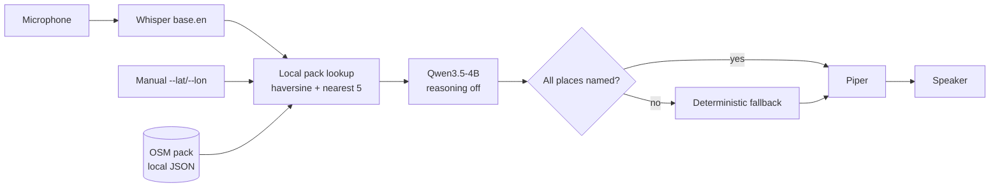

# Traily — Touch Grass

A screen-off, voice-first trail companion for the laptop. Ask "What's
nearby?" out loud; Traily answers with real nearby places, spoken back to
you. Built for Hacktoberfest 2026. English only, one fixed area at a time.

## The problem

On a trail you want answers without looking at a screen — and without a
network connection. Traily runs its whole pipeline (speech recognition,
local LLM, speech synthesis, offline map lookup) on an ordinary CPU-only
laptop.

## Working features

| Feature | Status |
|---|---|
| Microphone input (Bluetooth earbuds used successfully on Arch Linux) | Demonstrated on laptop |
| Speech-to-text, Whisper `base.en` via `whisper-cli` | Demonstrated (~0.9 s laptop) |
| Local LLM answers, Qwen3.5-4B Q4_K_M via `llama-cli`, CPU-only, reasoning off | Demonstrated |
| Nearby places from a local offline OSM pack | Demonstrated |
| Distances (haversine) + nearest-place selection in app code, never by the LLM | Unit-tested + demonstrated |
| Answers constrained to supplied places, completeness-checked, deterministic fallback | Unit-tested + demonstrated |
| Speech output, Piper `en_US-lessac-medium` | Demonstrated |
| Per-stage timings (record / STT / LLM / TTS / playback) | Demonstrated |
| Offline runtime after pack preparation | By design + socket-blocking tests |

## Architecture and data flow



One interaction per run: record (fixed window) → transcribe → look up the
nearest places in the selected local pack → generate a grounded answer →
synthesize and play it → print timings → exit. The LLM only ever receives
pre-computed `{name, type, distance_m}` items; if its answer omits a place,
a deterministic summary naming every place is spoken instead (no retries).

## Technology stack

- **STT:** whisper.cpp (`whisper-cli`), `base.en` model
- **LLM:** Qwen3.5-4B Q4_K_M GGUF via `llama-cli` (`-ngl 0 --reasoning off
  --jinja -st -c 2048 -b 128 -ub 64 -n 96`)
- **TTS:** Piper `en_US-lessac-medium` (via `piper-tts`, CPU-only)
- **Audio:** `parec` capture / `paplay` playback (PulseAudio) + stdlib `wave`
- **Maps:** OpenStreetMap via Overpass (prep only) → local JSON pack
- **Language:** Python 3.11+, stdlib plus `piper-tts`; no web frameworks,
  databases, or cloud SDKs in the runtime

## Requirements and installation

- Python 3.11+ (validated with 3.14), Arch Linux laptop used for demos
- System tools: `whisper-cli`, `llama-cli`, `parec`, `paplay`
- Model files (large — fetch once during setup, never auto-downloaded):

```bash
python3 -m venv .venv
.venv/bin/pip install -r requirements.txt   # piper-tts only
```

## Model setup and configuration

| Component | Default path | Override |
|---|---|---|
| Whisper `base.en` | `models/whisper/ggml-base.en.bin` | `TRAILY_WHISPER_MODEL` |
| Qwen3.5-4B Q4_K_M | `models/llm/Qwen3.5-4B-Q4_K_M.gguf` | `TRAILY_LLM_MODEL` |
| Piper voice | `models/piper/en_US-lessac-medium.onnx` | `TRAILY_PIPER_VOICE` |
| Place source | `data/places.json` (test fixture) | `TRAILY_PACK_FILE` / `--pack` |

See `.env.example` for all `TRAILY_*` settings (copy to `.env`, which stays
Git-ignored). The app never downloads weights at runtime; missing files
produce a clear error, not a download.

## Building and selecting an offline OSM pack

Packs are Git-ignored (an area can reveal personal location) — rebuild with:

```bash
.venv/bin/python scripts/build_pack.py --area "My Trail Area" \
    --bbox MIN_LON,MIN_LAT,MAX_LON,MAX_LAT --out data/packs/area.json
```

Bounding-box order is **MIN_LON,MIN_LAT,MAX_LON,MAX_LAT**. The builder makes
one Overpass request, validates and dedupes named places (nodes/ways/
relations), and refuses to write empty results. `--from-file
saved-response.json` rebuilds without re-querying.

Select a pack at runtime with `--pack data/packs/area.json` (default: the
small built-in test fixture). Two real packs were built this way:
`SJEC Campus Area` (5 places) and `SJEC and Vamanjoor, Mangaluru`
(12 places); both stay local.

## Running Traily

```bash
# Full voice interaction: press Enter, ask, hear the reply
.venv/bin/python src/main.py --pack data/packs/sjec-campus-area.json --lat 12.9107 --lon 74.8987

# Text mode (no mic/speaker needed)
.venv/bin/python src/main.py --text "What's nearby?" --no-playback \
    --pack data/packs/sjec-campus-area.json --lat 12.9107 --lon 74.8987
```

`--lat/--lon` are **manual test coordinates**, clearly labelled as such —
never live location (see Limitations). Without `--pack`, the built-in
fixture path runs unchanged. Useful knobs: `--record-seconds`,
`--workdir`, `--location-source gpsd` (needs a local GPSD receiver;
unverified — see Limitations).

## Running tests and the timing benchmark

```bash
.venv/bin/python -m unittest discover -s tests -v   # 126 tests, all offline/mocked
.venv/bin/python scripts/timing.py --no-playback    # benchmark, mic/STT skipped
```

## Measured performance

Current run on this machine (fixture path, text mode, all five places
named by the model):

| Stage | Measured |
|---|---|
| LLM (Qwen3.5-4B, reasoning off) | **17.01 s** |
| TTS synthesis (Piper) | **3.02 s** |
| Post-recording latency (record-finish → playback-start) | **20.04 s** — target NOT met |

OSM smoke test just now (SJEC pack, manual coords): LLM **23.49 s**,
TTS **3.50 s**, post-recording **26.99 s**; clean five-place answer
(produced via the deterministic fallback this run). Earlier laptop figures:
STT ~0.92 s, Piper ~2.05 s, standalone LLM ~4.13 s. The fixed 8 s recording
window counts toward total interaction time but is excluded from
post-recording latency (no voice-activity detection, so true end-of-speech
is unknown). The **8–10 s target is not met**; this is stated plainly and
tracked in `notes/failures.md`.

## Privacy and offline behavior

- **Runtime is offline by design:** mic → Whisper → local pack search →
  haversine → Qwen → Piper makes no network calls (unit tests block
  sockets during lookup; GPSD client allows 127.0.0.1 only).
- **Online only during preparation:** model downloads, `pip install`,
  and `build-pack` (one Overpass request). The runtime never queries
  Overpass per question.
- No IP geolocation or cloud positioning anywhere. Packs, `.env`, model
  binaries, and credentials are Git-ignored and never committed.

## Current limitations

- **No verified live GPS.** No receiver/daemon was found on the test
  machines; manual `--lat/--lon` is the working mode. Live offline
  location remains future work.
- **Latency target not met** (~20–27 s post-recording here vs 8–10 s goal).
- **Fixed recording window, no VAD** — silence records as silence (Whisper
  can hallucinate short words on pure silence).
- **Straight-line distances only** — no walking routes or turn-by-turn
  navigation, by design.
- **Small map coverage** — 5–12 real places in the demo packs; answers are
  only as good as local OSM mapping.
- **No outdoor field test documented yet.**
- Headless-container caveats: mic path and audible playback need the laptop
  (both degrade gracefully with clear errors).

## Scope note

This release is the working local voice companion using the **base
Qwen3.5-4B** model. Tinker fine-tuning and LoRA-adapter experiments live
separately (see `notes/` and the experimental `scripts/tinker_*.py`,
`src/finetune/` files, which are **not** required to install or run
Traily). There is no Render/Backboard deployment, web UI, or hosted
inference in this application, and this task spends none of the $10
Tinker credit.

## Acknowledgements and OpenStreetMap attribution

Built with open-source and open-weight technology: whisper.cpp,
llama.cpp, Piper, Python, and OpenStreetMap data.

Trail packs contain OpenStreetMap data:
© OpenStreetMap contributors — https://www.openstreetmap.org/copyright —
distributed under the Open Database License (ODbL). Each pack file embeds
this attribution, the source, and the license.
